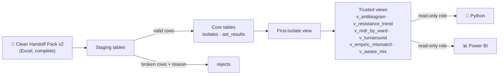
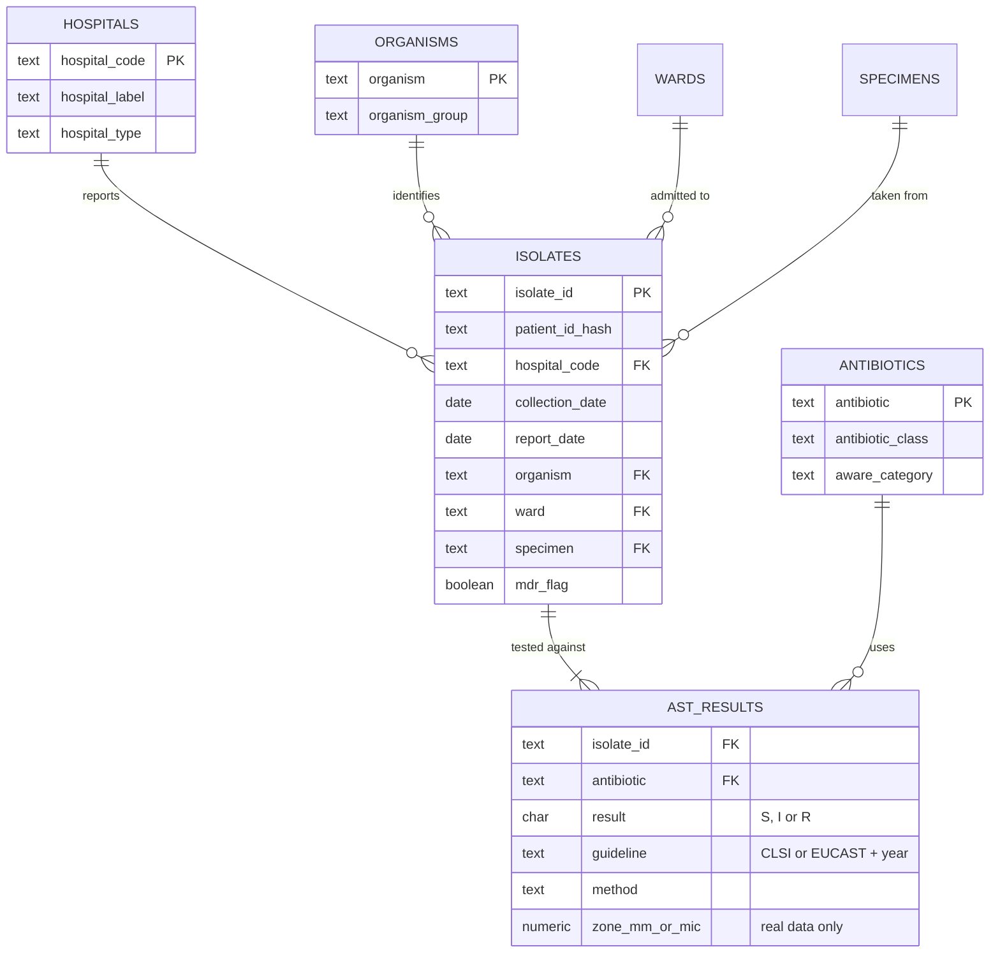

<div align="center">

# 🗄️ Kaduna AMR Watch — Database

**The single trusted home for every laboratory result, from practice data today to twenty real hospitals tomorrow.**


</div>

> [!IMPORTANT]
> **SYNTHETIC PRACTICE DATA.** Every number this database produces today comes from invented data. Never present it as a finding about Kaduna.

## Why this exists

Excel works one file at a time. A surveillance system receives new data every month, from many hospitals, for years. It needs one home with rules that stop bad data at the door, remove duplicates the same way every time, protect patient privacy, and give Python and Power BI **the same trusted numbers**.

## Where this sits



## Target data model (draft)

Finalised in the schema issue. Lookups are stored once, not repeated on 94,000 rows.



## The answer key

Every view must reproduce sheet `11_ANSWER_KEY` of the [Clean Handoff Pack](https://github.com/AMR-Playbook/.github/releases/tag/excel-handoff-v2):

| Check | Expected |
|---|---|
| Isolates loaded | 9,108 |
| AST test rows loaded | 94,454 |
| Orphan AST rows | 0 |
| *E. coli* + ceftriaxone 2024, % resistant | **61.66%** (201 of 326) |
| *K. pneumoniae* + meropenem 2024, % resistant | 16.26% (40 of 246) |
| MDR rate, all isolates | 85.74% (count isolates, not test rows) |

> [!WARNING]
> **The classic trap:** joining `isolates` to `ast_results` gives about ten rows per isolate. Counting isolates from that join inflates everything tenfold. Count isolates on `isolates`, and tests on `ast_results`.

## Layout

```
schema/      schema_v1.sql and constraints, builds everything from zero
load/        staging, validation and load scripts
views/       one file per view, each with a header comment explaining it
roles/       database roles and grants
docs/        ERD, design decisions, privacy checklist, view catalogue
```

## Getting started

1. Install PostgreSQL 16 and a client such as DBeaver or pgAdmin.
2. Download `Kaduna_AMR_Clean_Handoff_v2.xlsx` from the [release](https://github.com/AMR-Playbook/.github/releases/tag/excel-handoff-v2). **Never commit it.**
3. Pick an [open issue](../../issues) and read [CONTRIBUTING](https://github.com/AMR-Playbook/.github/blob/main/CONTRIBUTING.md).
