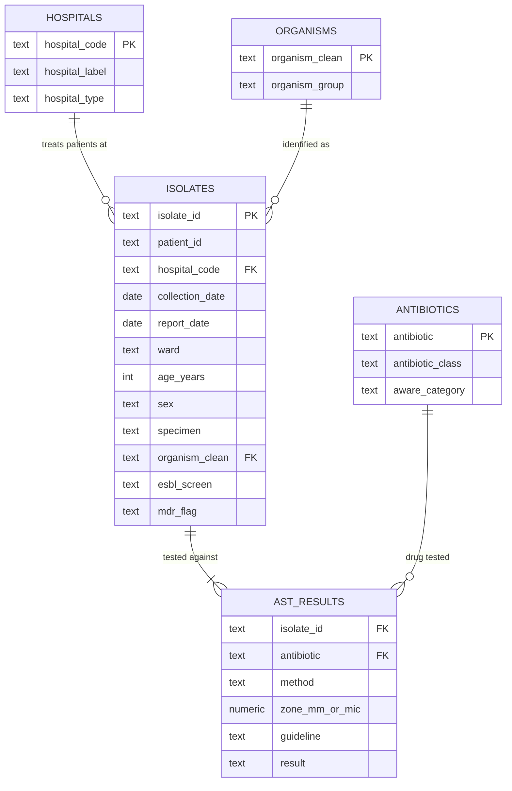

# kaduna-amr-sql · database

The home where Kaduna AMR Watch data lives. PostgreSQL schema, loading process, access control and the reporting views every other repository reads from.

> **The data here is synthetic.** It describes invented patients in four fictional hospitals and exists so the system can be built and tested before real hospital data is available. Never present it as a finding.

---

## What this repository is responsible for

Excel works for one file at a time. A surveillance system receives new data every month, from several hospitals, for years. It needs one organised home with rules that stop bad data at the door, remove duplicates consistently, protect patient privacy, and give every other tool the same trusted numbers.

If two dashboards disagree about "percent resistant", the fault is almost always here. One agreed definition of every number lives in this repository.

---

## The data model



One isolate is tested against roughly ten antibiotics, which is why there are about ten times more rows in `ast_results` than in `isolates`. **Counting isolates from a join of the two tables inflates every count tenfold.** This is the single most common error in this repository.

---

## Repository layout

```
seed/        The cleaned Excel workbook handed over by the data cleaning team
sql/
  schema.sql     Builds the whole database from nothing
  load.sql       Staging, validation and insert
  views.sql      The reporting views every tool reads
  roles.sql      Least-privilege analyst, loader and admin roles
  test_roles.sql Checks that the roles cannot exceed their permissions
docs/
  erd.md         Diagram and design decisions
  answer_key.md  The reference numbers every view must reproduce
  privacy.md     Identifier check, hashing rules and NDPA checklist
```

---

## Running it

```bash
createdb kaduna_amr
psql -d kaduna_amr -f sql/schema.sql
psql -d kaduna_amr -f sql/load.sql
psql -d kaduna_amr -f sql/views.sql
```

Expected after loading: **9,108 isolate rows**, **94,454 test rows**, **zero rejects**, **zero orphans**.

---

## Non-negotiables

1. Running the load twice must change nothing. Test this deliberately.
2. Every rejected row lands in a rejects table with a reason. Nothing is dropped silently.
3. Python and Power BI connect with a read-only role. Never admin.
4. Real data will mix CLSI and EUCAST breakpoints and will carry raw zone diameters or MIC values. The schema must have room for both even though the practice data has neither.
5. No view returns a percentage without also returning the count it was calculated from.
